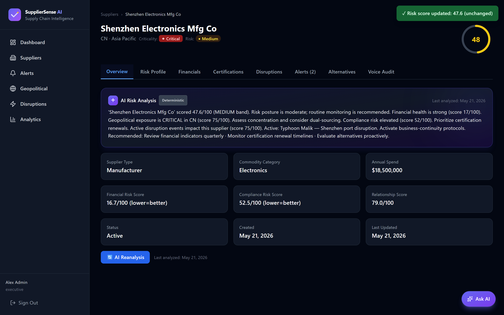
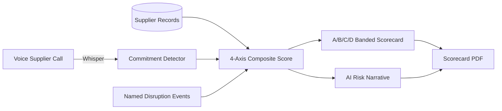
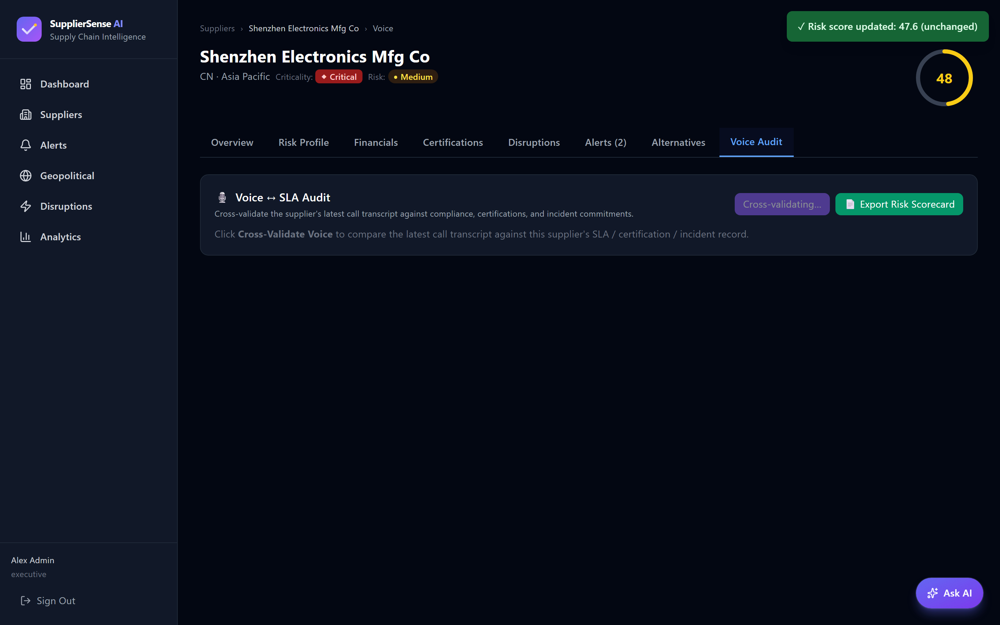
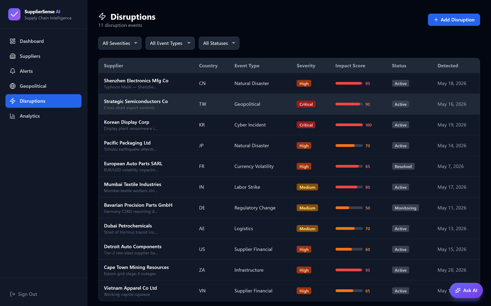
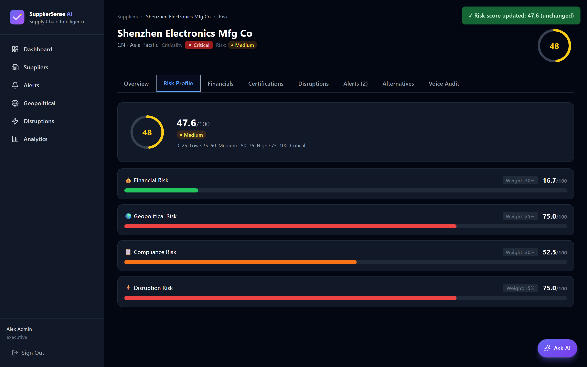
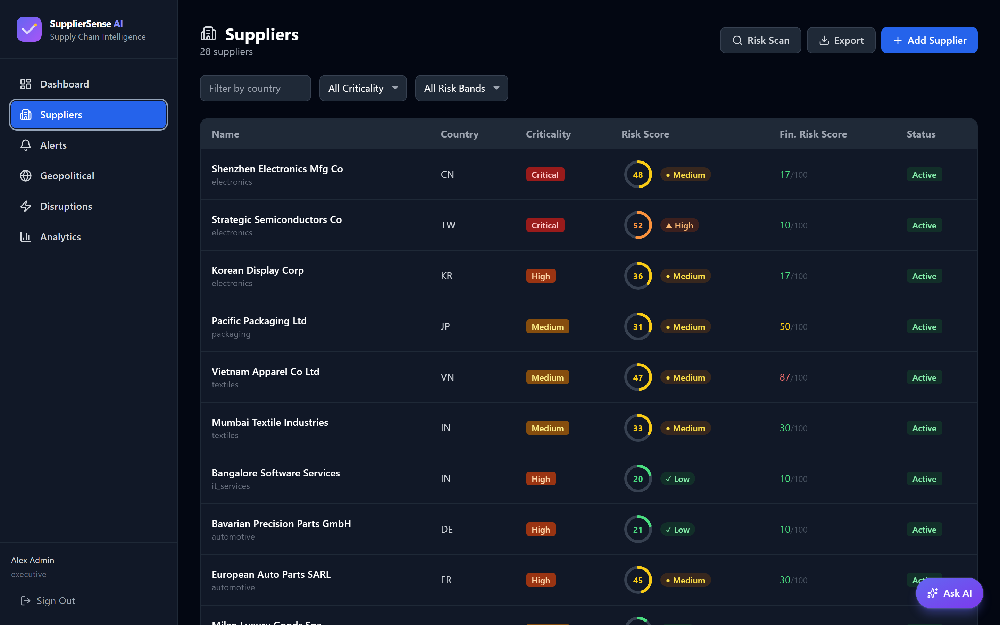
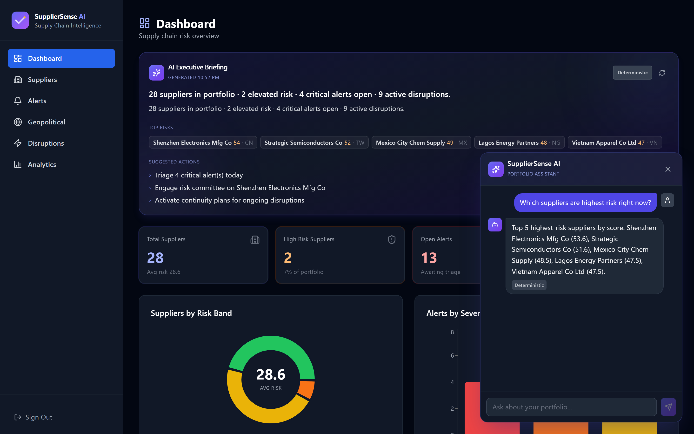
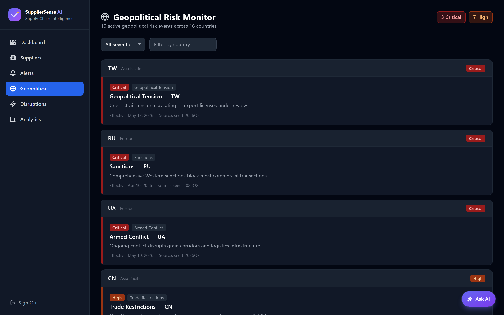
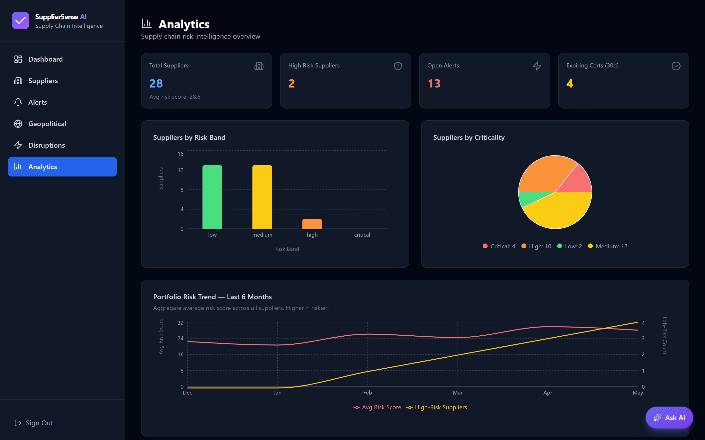

# SupplierSense AI

> Re-grades a supplier across financial, compliance, geopolitical, and disruption axes and writes the procurement narrative in 15 seconds — replacing a half-day analyst write-up per supplier.

<p align="center">
  
</p>

---

## The problem

Procurement analysts at enterprises with **500+ active suppliers** are responsible for re-grading every supplier quarterly across financial health, compliance posture, geopolitical exposure, and disruption events. A typical write-up is half a day per supplier: pull financial filings, check certification status, scan news for disruptions, weight the result. The portfolio review is two weeks per quarter, even with a team.

## What this does

SupplierSense pulls supplier records, monitors disruption events (named storms, port closures, geopolitical alerts), runs voice supplier-call analysis (commitment detection, SLA cross-check, certification renewal mentions), computes a four-axis composite risk score with criticality weighting, surfaces the active disruption event by name (e.g., "Typhoon Malik — Shenzhen port disruption"), generates an A/B/C/D banded scorecard PDF, and writes the AI risk narrative for the senior buyer. Each analysis is marked Deterministic or AI-enriched so the buyer knows the run mode.

## Real-world scenario

> A category manager opens *Shenzhen Electronics Mfg Co* on Monday morning. SupplierSense shows: composite **47.6/100 (MEDIUM band)**; **Financial 16.7 (strong)**, **Compliance 52.5 (elevated — certification renewal upcoming)**, **Relationship 79 (good)**, **Geopolitical 75 (CRITICAL — concentration in CN)**, **Disruption 75 (Active: Typhoon Malik — Shenzhen port disruption — activate business-continuity protocols)**. The AI narrative recommends *Review financial indicators quarterly · Monitor certification renewal timelines · Evaluate alternatives proactively*. The manager triggers an alternative-supplier scan and emails the scorecard to procurement leadership.

## Why it saves time

| Metric | Manual approach | SupplierSense | Improvement |
|---|---|---|---|
| Per-supplier review | half a day | **~15 s compute + ~5 min review** | ~30× faster |
| Disruption-event surfacing | by news scan | named active events in-line | qualitative |
| Banded grading | by hand | A/B/C/D bands keyed to risk_score × criticality | systematic |

## Key features

- **Four-axis composite risk score** — financial, compliance, geopolitical, disruption.
- **Named disruption events** (e.g., "Typhoon Malik — Shenzhen port disruption") in-line on the supplier card.
- **A/B/C/D banded scorecard** with criticality weighting per supplier.
- **AI Risk Analysis narrative** marked Deterministic or AI-enriched.
- **Voice supplier-call analysis** — commitment detection (certifications, incident acknowledgments, delivery commitments, price commitments) with severity and recommended actions.
- **`risk_score` mutation** — voice findings clamp into 0–100.
- **Alternative-supplier scan** triggered from a single click on a critical supplier.
- **Banded scorecard PDF** for procurement leadership.

## How it works

The non-obvious decision was to **surface named disruption events as first-class entities**, not as generic "disruption risk" scores. Procurement buyers don't react to "geopolitical risk = 75"; they react to "Typhoon Malik shut the Yantian terminal yesterday." The system maintains a named-event catalog (storms, port closures, sanctions changes) and links each event to its affected suppliers. The composite score moves automatically when an event is added.

## Architecture



## Screenshots

### AI risk narrative


### Voice supplier audit



### Disruptions



### Risk profile



### Suppliers grid



### Ask AI widget



### Geopolitical view



### Analytics



## Stack

- **Backend:** `fastapi`, `sqlalchemy` + PostgreSQL, `openai` SDK via DeepInfra (Whisper for supplier calls + GPT for narrative), `reportlab` (scorecard PDF).
- **Frontend:** `react` + `vite`, `@tanstack/react-query`, `recharts` (radar + heatmap).
- **Infra:** Docker Compose (api, worker, postgres, redis, frontend).

## Quick start

```bash
git clone https://github.com/Guembri01/suppliersense-ai.git
cd suppliersense-ai
cp .env.example .env   # DEEPINFRA_API_KEY, OPENAI_API_KEY, JWT_SECRET
docker compose up -d
# API: http://localhost:8030/docs — UI: http://localhost:5030
```

## Limitations

- **Named-event catalog is curated.** Live OSINT crawling for storms / sanctions / port closures is a roadmap item.
- **English supplier calls only.** Multilingual supplier calls (e.g., Mandarin) require Whisper-multilingual + translation pre-processing.
- **No direct ERP integration today.** Suppliers are loaded via CSV / API; bidirectional sync with SAP Ariba / Coupa is on the roadmap.
- **Banded grading thresholds are global.** Per-category thresholds (electronics vs commodities) need configurable cut-offs.

## Roadmap

- [ ] Live OSINT crawl for disruption events.
- [ ] Mandarin / Spanish / French supplier-call support.
- [ ] SAP Ariba + Coupa bidirectional sync.
- [ ] Per-category band thresholds.
- [x] Four-axis composite scoring.
- [x] Named disruption events.
- [x] A/B/C/D banded scorecard PDF.
- [x] Voice supplier-call commitment detection.

## What I learned

- **Naming the disruption event** changed the way buyers reacted — abstract risk numbers don't move procurement, named events do.
- **Deterministic mode marking on every AI narrative** was what got the procurement leadership over the "is this an LLM or a calculation?" trust gate.

## License

Released under the [MIT License](LICENSE).

## Acknowledgements

Built with [FastAPI](https://fastapi.tiangolo.com/), [SQLAlchemy](https://www.sqlalchemy.org/), [React](https://react.dev/), [Whisper](https://github.com/openai/whisper) via [DeepInfra](https://deepinfra.com/), and [ReportLab](https://www.reportlab.com/).
